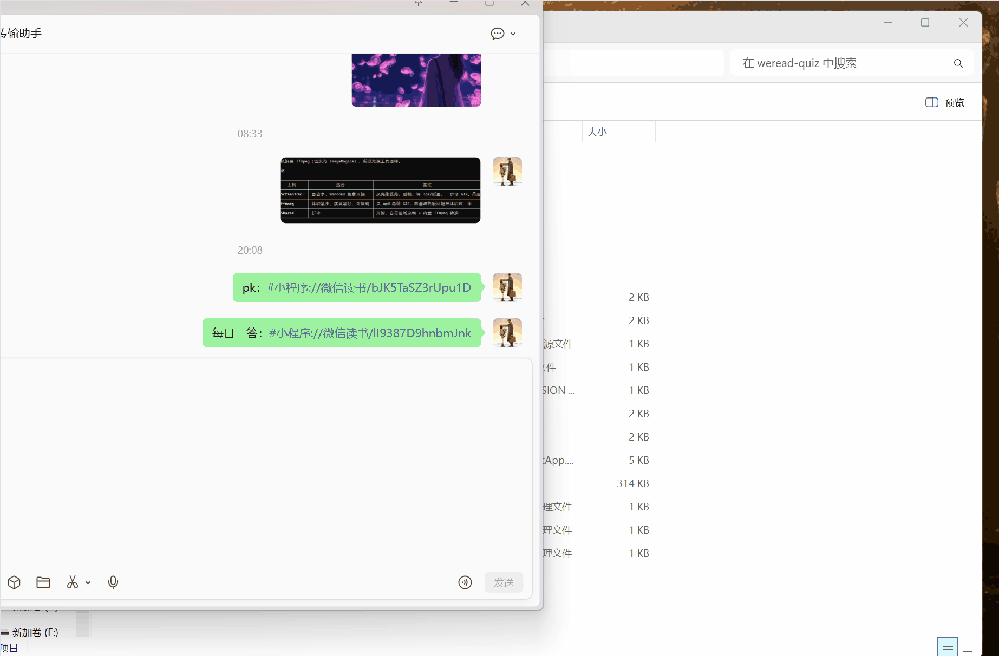
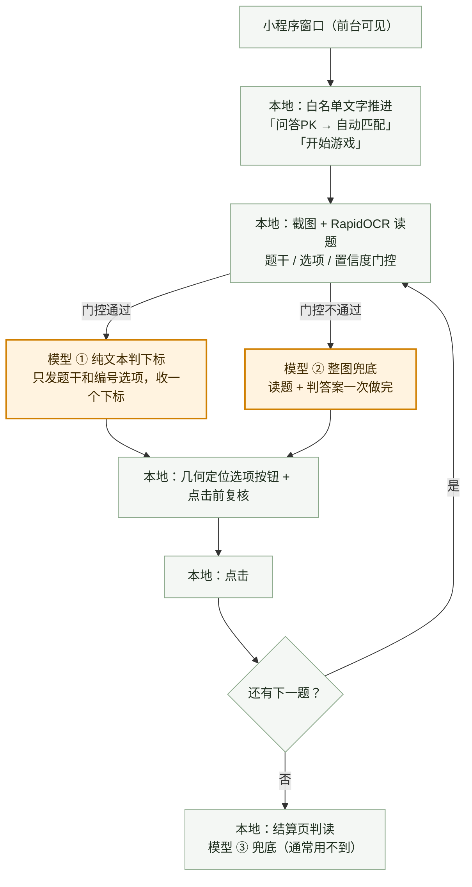

# weread-quiz

   

微信读书「每日一答」/「问答 PK」自动答题工具（Windows）。

抓小程序界面截图 → 本地 OCR 读题 → 模型判答案 → 定位选项按钮 → 点击前复核 → 逐题答完整局。
只认明确证据：认不出页面、读不出题、模型给不出合法下标时，程序会停下并留证，而不是猜着点。

**模型只判哪个选项对**，其余全在本地跑完：一局实测约 3.6K token、12 次请求（10 题）。

> **仅供学习研究使用，如有侵权，请联系删除！**


<p align="center"><sub>问答 PK 自动答题过程录屏（节选）</sub></p>

## 工作流程



**模型只干一件事：判哪个选项对。** 找窗口、抓屏、读题、定位按钮、判断换题、点击前复核、点击 —— 全是本地代码跑完的，不消耗 token。

**模型一共只有这三处调用：**

| 调用 | 什么时候发生 | 发给模型的东西 | 频率 | 实测 token（输入 / 输出） |
|------|-------------|---------------|------|------------------------|
| ① 判下标 | 每道题的主路径 | 题干 + 编号选项，纯文本 | 每题 1 次 | ~250 / 8~350 |
| ② 整图兜底 | 本地 OCR 门控不通过（置信度不足、选项数与按钮数对不上、没读出） | 整张截图 | 偶发，10~12 题里通常 0~1 次 | ~520~810 / 更多 |
| ③ 结算页判读 | 本地 OCR 没读到明确的胜负或积分 | 结算截图 | 每局最多 1 次，通常用不到 | ~800 |

**一局大概烧多少**（`data/runs/*/run.log` 里的真实记录）：

| 一局 | 请求次数 | 输入 | 输出 | 合计 |
|------|---------|------|------|------|
| 问答 PK（10 题） | 12 次 | 3.08K | 596 | **3.68K** |
| 每日一答（12 题） | 13 次 | 1.72K | 1.85K | **3.57K** |

请求次数只跟题数成正比（每题 1 次）；识别失败重试也只把同一道题的请求数翻一倍（`VISION_RETRIES`，默认 1），不会因为复核、点击重来而放大。发出去的只有题面文字（主路径）或截图（兜底路径），发到 `.env` 里配的那个端点。

## 快速开始

```bash
# 1. 装依赖（需要 Python 3.10+）
uv sync

# 2. 配模型（OpenAI 兼容端点）
cp .env.example .env
# 编辑 .env，填 MODEL_BASE_URL / MODEL_API_KEY / MODEL_NAME

# 3. 在微信里打开微信读书小程序（游戏中心入口页）

# 4. 双击项目根目录的「启动PK.bat」
```

第 3 步的直达链接（复制到微信「文件传输助手」再点开；`#小程序://` 协议在浏览器里点不开）：

| 入口 | 链接 |
|------|------|
| 问答 PK | `#小程序://微信读书/bJK5TaSZ3rUpu1D` |
| 每日一答 | `#小程序://微信读书/lI9387D9hnbmJnk` |

**小程序窗口不能被遮挡，要留在最外层（前台可见）** —— 程序是按它在屏幕上的位置截图并点击的，盖住或压到后面就会抓错画面。

离线回归测试 373 项（不需要真微信和网络）：`uv sync --extra dev && pytest`

## 启动器

项目根目录有三个启动器，双击即可：

| 启动器 | 作用 |
|--------|------|
| `启动PK.bat` | 问答 PK：自动匹配 → 答完整局（常规 10 题，平局加时赛会接着答） |
| `启动每日一答-瓜分天数.bat` | 每日一答：瓜分天数路线 → 答完 12 题 |
| `启动每日一答-瓜分书币.bat` | 每日一答：瓜分书币路线 → 答完 12 题 |

命令行形式等价：

```bash
weread-quiz pk --dry-run    # 只识别不点击
weread-quiz pk              # 跑一局 PK
weread-quiz pk --trace      # 详细日志打到终端
weread-quiz daily           # 跑一局每日一答（--route daily-days / daily-coins）
weread-quiz clean           # 清理旧截图（保留最近 30 天）
```

## 使用

**前提**：微信读书小程序已经打开，停在游戏中心入口页，程序才能接手推进（直达链接见上面「快速开始」）。

在微信里打开对应小程序 → 双击对应启动器 → 程序自己推进到答题页并开始作答。

**紧急中止**：按 **Esc** 键，程序会停下。

### 注意

- **小程序窗口不能被遮挡，要留在最外层。** 被别的窗口盖住就会抓错画面。
  程序启动后会**自动把小程序窗口抬到前面并置顶**（跑完还原）；控制台正好压着它时会把控制台挪开。
  小程序是 GPU 合成窗口，失去焦点会停止渲染 —— 程序会保持它在前台，必要时重新激活（白屏自愈）。
- **Windows 显示缩放不用调。** 100%/125%/150%/200% 都支持 —— 抓屏会归一化到标定宽度，点击坐标按物理窗口换算。
- **不要同时跑两个启动器。** 没有跨进程互斥，两个进程抢桌面会互相干扰。
- **正式每日一答答错即当日机会用完**，不可恢复。
- **不会使用任何道具**（跳题卡 / 换题卡 / 续命卡一律不碰），也不会自动点「取消匹配」或「邀请好友」。
- 每日一答活动页上有两张卡片，两个启动器各走一条路线，**互不干扰**。
- PK 的平局加时赛会继续出题，程序接着答到结算页出现为止（不是答满 10 题就停）。

## 配置

全部通过 `.env`（说明见 `.env.example`）：

| 变量 | 默认 | 说明 |
|------|------|------|
| `MODEL_BASE_URL` / `MODEL_API_KEY` / `MODEL_NAME` | 必填 | OpenAI 兼容端点。**换供应商只改这三行**，代码不用动 |
| `MODEL_THINKING` | `1` | 是否让模型输出思考块。**PK 不要关**：实测快 312ms/题，但 10 道真实题里 2 道的答案会变 |
| `VISION_RETRIES` | `1` | 视觉模型失败后的重试次数。PK 时间预算紧，重试 2 次必然超时 |
| `GUESS_ON_FAILURE` | `1` | 模型失败时是否点第一个按钮（超时惩罚与答错相同，蒙有 25~33% 机会） |
| `OCR_MIN_CONFIDENCE` | `0.7` | PK 本地 OCR 最低置信度，低于阈值转图片路径 |
| `DAILY_OCR_MIN_CONFIDENCE` | `0.85` | daily 的阈值，独立于 PK |
| `PK_NEXT_QUESTION_DELAY` | `1.0` | PK 点击后开始检查下一题的固定延迟（秒） |
| `PK_OCR_FALLBACK_SECONDS` | `3.0` | PK 本地 OCR 连续判否后，允许一次视觉兜底的等待时间（秒） |

## 已知限制

- 仅 Windows，依赖 mss 抓屏 / RapidOCR 本地识别 / pyautogui 点击。
- 强依赖界面几何（按钮边框颜色、题干 y 区间）。小程序改版后判据可能失效。
- 视觉模型偶发 6~8 秒慢响应，PK 倒计时 9~12 秒会偶发超时；单次调用超过 **11 秒**即放弃，该题蒙一个。
- `data/` 截图与日志会被 `clean` 定期清理（默认保留 30 天），需要长期留存请手动备份。

## 支持与反馈

如果它对你有用，欢迎点个 ⭐（Star）；也欢迎提 Issue —— 界面判据、预算策略、模型调用边界这几块都还有优化空间。

## License

MIT，见 [LICENSE](LICENSE)。

本项目仅供学习研究使用，如有侵权，请联系删除！第三方模型和微信相关素材的权利不因本项目 LICENSE 而改变。
