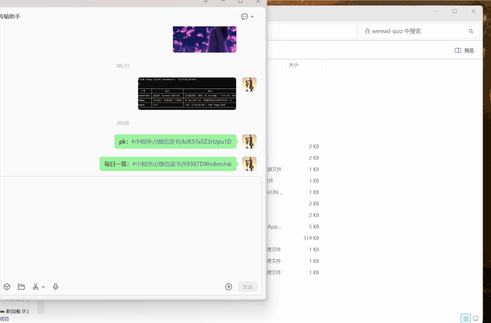

<div align="center">

# weread-quiz

**微信读书「问答 PK」与「每日一答」自动答题工具**

打开小程序，双击启动器，让本地 OCR 和模型配合作答。

[](https://github.com/StrayRabbit/weread-quiz/releases/latest)


[](LICENSE)

[下载免安装包](https://github.com/StrayRabbit/weread-quiz/releases/latest) · [快速开始](#快速开始) · [模型配置](#模型配置) · [使用须知](#使用须知) · [反馈问题](https://github.com/StrayRabbit/weread-quiz/issues)



<sub>问答 PK 自动答题演示（节选）</sub>

</div>

## 特点

- **解压即用**：Windows 免安装包自带便携 Python，无需安装 Python 或 uv。
- **三条答题路线**：支持问答 PK、每日一答瓜分天数、每日一答瓜分书币；PK 平局后继续加时赛。
- **本地识别，模型判答**：截图、OCR、按钮定位和点击复核在本地完成，通常只把题干与选项发给模型；需要时才用截图兜底。
- **模型自由搭配**：支持 OpenAI 兼容接口及决策模型，可额外配置视觉模型进行复核与读图兜底。
- **点击前再确认**：页面或同题身份无法确认时不点击并留证；支持 **Esc** 紧急中止。

> [!WARNING]
> 模型可能答错，超时或无有效答案时默认也可能蒙答。**正式每日一答答错会用完当日机会，无法恢复。** 使用前请阅读[使用须知](#使用须知)。本项目仅供学习研究使用。

## 快速开始

### 1. 下载并解压

从 [Releases](https://github.com/StrayRabbit/weread-quiz/releases/latest) 下载 **`weread-quiz-v*-win64.zip`**，解压后运行，不需要另装 Python 或 uv。

### 2. 填写模型配置

双击 **`首次配置.bat`**，在打开的 `.env` 中填写以下三项并保存：

```dotenv
MODEL_BASE_URL=你的模型接口地址
MODEL_API_KEY=你的 API 密钥
MODEL_NAME=你的模型名称
```

接口地址、密钥和模型名从模型供应商后台获取。不要保留模板占位符；模型服务的费用与可用性以供应商为准。搭配方式见[模型配置](#模型配置)。

### 3. 打开小程序，选择启动器

在 **Windows 微信客户端**中打开微信读书小程序，停在游戏中心入口页，然后双击对应启动器：

| 启动器 | 答题路线 |
| --- | --- |
| `启动PK.bat` | 自动匹配 → 问答 PK；常规 10 题，平局继续加时赛 |
| `启动每日一答-瓜分天数.bat` | 每日一答 → 瓜分天数，12 题 |
| `启动每日一答-瓜分书币.bat` | 每日一答 → 瓜分书币，12 题 |

运行时保持小程序窗口可见、无遮挡；需要停止时按 **Esc**。不要同时运行多个启动器。

<details>
<summary>找不到入口？使用小程序直达链接</summary>

复制到微信「文件传输助手」后点开，浏览器无法直接打开 `#小程序://` 链接。

| 入口 | 链接 |
| --- | --- |
| 问答 PK | `#小程序://微信读书/bJK5TaSZ3rUpu1D` |
| 每日一答 | `#小程序://微信读书/lI9387D9hnbmJnk` |

</details>

## 模型配置

**主模型必填，视觉模型可选。** 所有配置写在项目或解压目录的 `.env` 中。

| 搭配 | 适用情况 | 注意 |
| --- | --- | --- |
| 一个支持读图的多模态模型 | 希望配置简单 | 主模型同时负责文本判答与截图兜底 |
| 决策模型 + 视觉模型 | 希望兼顾速度与准确率 | 决策模型先判答，低置信度时交给视觉模型复核；OCR 不可靠时由视觉模型读图 |
| 仅决策模型或纯文本模型 | 只使用文本判答 | 不具备截图兜底能力，OCR 不可靠时可能无法得到答案 |

主模型填写 `MODEL_BASE_URL` / `MODEL_API_KEY` / `MODEL_NAME`。如果需要独立的视觉模型，在 `.env` 中补充以下三项，**要么全部填写，要么全部不填**：

```dotenv
VISION_BASE_URL=视觉模型接口地址
VISION_API_KEY=视觉模型 API 密钥
VISION_NAME=支持读图的模型名称
```

> [!TIP]
> 接口兼容不代表模型支持读图。选择纯文本模型或决策模型时，建议额外配置支持图片输入的视觉模型。

<details>
<summary>进阶：完整参数与超时策略</summary>

`.env.example` 只列常用项，其他参数可自行添加到 `.env`，修改后重启生效。布尔项使用 `1` / `0`，也支持 `true` / `false`、`yes` / `no`、`on` / `off`。

### 完整参数

| 变量 | 默认值 | 说明 |
| --- | --- | --- |
| `MODEL_BASE_URL` / `MODEL_API_KEY` / `MODEL_NAME` | 必填 | 主模型接口、密钥与模型名 |
| `VISION_BASE_URL` / `VISION_API_KEY` / `VISION_NAME` | 不配置 | 可选视觉模型，三项必须配齐 |
| `MODEL_THINKING` | `1` | 是否开启思考，不影响决策模型。是否生效取决于端点，当前仅适配 MiniMax 的关闭参数；不建议为提速关闭，部分模型强制要求开启 |
| `MODEL_MIN_CONFIDENCE` | 留空（自动） | 决策模型的复核门槛。配了视觉模型时默认 `0.8`，未配则不复核；`0` 明确关闭复核；范围 `0`～`1` |
| `VISION_RETRIES` | `1` | 视觉模型失败后的重试次数，非负整数；增加重试会占用单题预算 |
| `GUESS_ON_FAILURE` | `1` | 仅控制 PK：无有效答案时，是否在同题复核通过后点第一个选项 |
| `DAILY_USE_PROPS_ON_FAILURE` | `0` | 每日一答无有效答案时，优先跳题卡、其次换题卡，详见下方道具说明 |
| `OCR_MIN_CONFIDENCE` | `0.7` | PK 本地 OCR 最低置信度，低于阈值转图片路径；范围 `0`～`1` |
| `DAILY_OCR_MIN_CONFIDENCE` | `0.85` | 每日一答本地 OCR 阈值，与 PK 独立；范围 `0`～`1` |
| `PK_NEXT_QUESTION_DELAY` | `1.0` | PK 点击后开始检查下一题的固定延迟，单位秒，不能为负数 |
| `PK_OCR_FALLBACK_SECONDS` | `3.0` | PK 本地 OCR 连续判否后，允许一次视觉兜底的等待时间，单位秒，不能为负数 |
| `PK_TEXT_TIMEOUT` | `12.0` | PK 文本阶段（含复核）的最大用时，单位秒，必须大于 `0`；仍受当题剩余预算限制，不控制每日一答 |

降低 OCR 阈值可能放行错误题干或选项。建议先查看运行日志的回退原因，而不是一味降低阈值。

### 模型慢或超时怎么办

**PK** 每题约 12 秒，识别和点击共享预算。可靠倒计时下，扣除本地 OCR 耗时并预留 0.8 秒用于超时退出、复核和点击，其余尽量给文本模型。

- `PK_TEXT_TIMEOUT` 是最大值，不是每题必定能等这么久。旧 `.env` 若仍设置 `6.5` 等较小值，需要手动调高才能用足预算。
- 文本超时直接进入失败处理，不再串行请求图片。
- OCR 不可靠时直接走图片；文本提前返回无效答案且剩余预算足够时，仍可图片兜底。
- 模型最终失败时，默认在同题复核通过后蒙第一个选项；`GUESS_ON_FAILURE=0` 可关闭。

**每日一答**采用相同的文本优先策略，但保持固定 **9 秒总识别预算**，不受 `PK_TEXT_TIMEOUT` 控制。OCR 不可靠或文本提前返回无效答案时，预算足够才走图片；文本超时后经同题复核再处理失败，默认可能蒙答。

延长等待不能保证模型及时返回，也不能解决答错。优先选择响应稳定、速度合适的模型。

### 每日一答道具

自 v1.0.4 起支持。在 `.env` 设置 `DAILY_USE_PROPS_ON_FAILURE=1` 开启，默认关闭。

1. 仅在模型最终无有效答案时使用已有道具，优先跳题卡、其次换题卡。
2. 数量大于 `0` 且按钮处于亮色才使用；末题不使用跳题卡。
3. 换题后在同一题位重新识别，不增加已完成题数；跳题单独计数。
4. 道具点击后无法确认生效，会留证并停止，不重复消耗。

关闭或无可用道具时仍按原逻辑蒙答，**并非保证保留当日机会**。不使用续命卡，不影响 PK。换题卡的可用态与实际点击流程尚缺少实机验证，当前由离线测试覆盖。

</details>

## 使用须知

- **桌面环境**：仅支持 Windows 10/11。小程序窗口不能被遮挡；程序会将其前置、置顶，结束后还原置顶状态。显示缩放无需改为 100%，支持 100% / 125% / 150% / 200%。
- **失败时的行为**：读题或判答失败时，根据模型能力和剩余预算尝试图片兜底；文本超时不再串行回退图片。仍无答案时，默认在同题复核通过后蒙第一个选项。PK 可用 `GUESS_ON_FAILURE=0` 关闭蒙答，**此开关不控制每日一答**。
- **每日一答与道具**：默认不使用道具，答错会用完当日机会。设置 `DAILY_USE_PROPS_ON_FAILURE=1` 后，无有效答案时优先尝试已有跳题卡、其次换题卡；关闭或无可用道具时仍可能蒙答。详见上方模型配置折叠区的道具说明。不使用续命卡。
- **操作边界**：不要同时运行两个启动器，也不要在答题时手动切页。程序不会自动点击「取消匹配」或「邀请好友」。
- **数据与隐私**：文本路径向配置的模型端点发送题干与选项；图片路径会发送小程序截图。运行日志及截图保存在本地 `data/runs/`，反馈问题前请检查并遮盖个人信息，勿上传 `.env` 或 API 密钥。

## 源码运行

需要 **Python 3.10+** 和 [uv](https://docs.astral.sh/uv/getting-started/installation/)。下载或克隆源码后，在项目根目录执行：

```powershell
uv sync
```

双击 `首次配置.bat` 填写 `.env`，再使用上述启动器；也可以从命令行启动：

```powershell
uv run weread-quiz pk
uv run weread-quiz daily --route daily-days
uv run weread-quiz daily --route daily-coins
```

只识别、不点击时使用 `uv run weread-quiz pk --dry-run` 或 `uv run weread-quiz daily --dry-run`，需先手动进入答题页。PK 详细日志使用 `uv run weread-quiz pk --trace`。

## 开发与验证

<details>
<summary>离线测试与构建免安装包</summary>

```powershell
uv sync --extra dev
uv run pytest
uv run python tools/build_release.py
```

测试为离线回归，不需要真实微信和外网；构建产物为 `dist/weread-quiz-v*-win64.zip`。推送 `v*` tag 会触发 GitHub Actions 自动构建与发布。

</details>

版本变化见[更新记录](CHANGELOG.md)。

欢迎通过 [Issue](https://github.com/StrayRabbit/weread-quiz/issues) 反馈问题，附上版本、路线和脱敏日志；如果工具对你有用，也欢迎点个 Star。本项目分享于 [LINUX DO 社区](https://linux.do/)，欢迎交流。

项目采用 [MIT 协议](LICENSE)。第三方模型与微信相关素材的权利不因本项目许可而改变；如有侵权，请联系删除。
